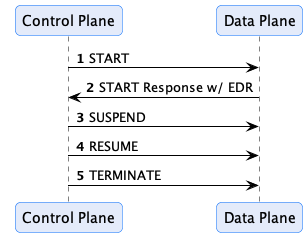

A data plane is responsible for transmitting data using a wire protocol at the direction of the control plane. Data planes
can vary greatly, from a simple serverless function to a data streaming platform or an API that clients access. One
control plane may manage multiple data planes that specialize in the type of data sent or the wire protocol requested by
the data consumer. This section provides an overview of how data planes work and the role they play in a dataspace.

## Separation of Concerns

A data plane is a separate component from the control plane, deployed and scaled on its own, e.g. as a separate set of
instances in a Kubernetes cluster. The two talk to each other through the
[Data Plane Signaling (DPS)](https://eclipse-dataplane-signaling.github.io/dataplane-signaling) protocol: at runtime, a data
plane registers with a control plane, which in turn directs the data plane through DPS.

EDC doesn't include a data plane. Any application that implements DPS can be one:

- an existing data plane that speaks DPS, such as
  [`siglet`](https://github.com/eclipse-dataplane-core/siglet);
- a data plane of your own, built with one of the [Data Plane SDKs](https://github.com/eclipse-dataplane-core)
  ([Java](https://github.com/eclipse-dataplane-core/dataplane-sdk-java),
  [Go](https://github.com/eclipse-dataplane-core/dataplane-sdk-go),
  [Rust](https://github.com/eclipse-dataplane-core/dataplane-sdk-rust)), or directly on the specification.

In either case, understanding the data plane registration process and the signaling flow are the first steps.

## Data Plane Registration

In the EDC model, control planes and data planes are dynamically associated. At startup, a data plane registers itself
with the control plane through the Management API (`PUT /v4/dataplanes`, or
`PUT /v5/participants/{participantContextId}/dataplanes` for a participant context). Registration is idempotent and
persistent, and made available to all clustered control plane runtimes via persistent storage. A data plane that shuts
down for good deregisters itself (`DELETE`). The control plane doesn't check whether a registered data plane is
available: making data planes available, e.g. by running several replicas behind a load balancer, is the job of the
infrastructure.

The registration includes the data plane's:
- endpoint, at which the control plane sends it signals;
- supported transfer types, i.e. the DPS profiles it implements, for example `HttpData-PULL`;
- labels, which assets can require of the data plane that transfers them;
- authorization profile, see [Securing the Signaling API](#securing-the-signaling-api).

The control plane uses this metadata for two purposes. First, it is used to determine which transfer types are available
for an asset when generating a catalog: those of the registered data planes or, if the asset lists profiles in its
`dataplaneMetadata`, those of the data planes that support one of them. Second, it is used to select a data plane when
a transfer process is requested: one that supports the transfer type and has all the labels the asset requires.

## Data Plane Signaling

A control plane communicates with a data plane through the RESTful interfaces defined by DPS: the control plane sends
signals to the data plane, and the data plane notifies the control plane of the progress of a transfer. Any data plane
that implements DPS and registers with the control plane can be used.

The Data Plane Signaling flow is shown below:

When a transfer process is requested, the consumer control plane selects a data plane and sends it a prepare message.
The provider control plane, once it accepts the request, selects a data plane and sends it a start message. A data plane
answers with the *data address* of the transfer when there is one: for a pull transfer, the provider data plane returns
the endpoint (and the credentials, if needed) at which the consumer gets the data; for a push transfer, the consumer data
plane returns the destination the provider pushes the data to. The control planes don't create or interpret data
addresses, they pass them to the counter-party through the Dataspace Protocol, and the consumer control plane hands the
provider's data address to its data plane with a started message.

A data plane can also answer asynchronously, and report the outcome later through the control plane's Signaling API
(prepared, started). The control plane may send additional signals, such as SUSPEND and RESUME, or TERMINATE, in
response to events. For example, the control plane policy monitor could send a TERMINATE message if a policy violation
is encountered.

A signal that can't be delivered (timeout, connection error), or that the data plane answers with a 5xx, is sent again
by the transfer process state machine, with the delays and the limit of `edc.transfer.send.retry.*`. A signal the data
plane rejects with a 4xx fails the transfer process. A data plane that needs long to prepare or start a data flow should
answer asynchronously: when the response to `prepare` or `start` is lost, e.g. because it takes longer than
`edc.http.client.timeout.read` (30 s), the signal is sent again, and the data plane rejects it for the data flow it
already created (see [State Machines Known Limitations](../control-plane/state-machines/_index.md#common-to-both-state-machines)).

### Securing the Signaling API

The data plane notifies the control plane of the progress of a transfer (prepared, started, completed, errored) by
calling the Signaling API of the control plane, which is served on its own port and path (`web.http.signaling.port`,
default `8182`, and `web.http.signaling.path`, default `/api/signaling`). How these calls are authenticated depends
on the authorization profile a data plane provides when it registers:

- **With an authorization profile** (e.g. `oauth2_client_credentials` or `oauth2_token_exchange`), the control plane
  authenticates every call and checks that it comes from the data plane that handles the transfer.
- **Without an authorization profile**, the calls are not authenticated: any client that can reach the Signaling API
  and knows the id of a transfer process can change its state. This fits a deployment in which the control plane and
  its data planes run in the same trusted network. The control plane logs a warning when such a data plane registers.

Expose the Signaling API only on the internal network. Register the data planes with an authorization profile when the
Signaling API can be reached from outside that network, or when the data planes of several participant contexts share
it, as in a multi-tenant deployment.
